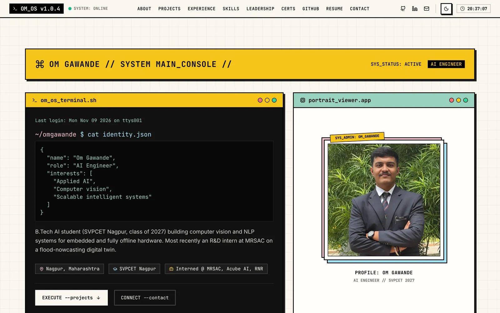

# OM_OS: Om Gawande's portfolio

**Live:** https://om-os.vercel.app

OM_OS is my portfolio, styled as a neo-brutalist operating system: yellow/black windows, JetBrains Mono + Inter, light and dark themes. It covers my projects, MRSAC and industry internships, skills, leadership, certifications, a GitHub activity panel, my resume and a contact form.

Every claim on the site is sourced from a project README, my resume, or my own confirmation. See [`CLAIMS_TO_VERIFY.md`](CLAIMS_TO_VERIFY.md).

## Stack

- React 19 + TypeScript, Vite 7, Tailwind CSS 3
- Prerendered at build time (`react-dom/static`), then hydrated
- three.js background grid, lazy-loaded on desktop only
- No animation library: an `IntersectionObserver` hook plus CSS, respecting `prefers-reduced-motion`
- Deployed on Vercel (`vercel.json` sets caching and security headers)

## Content model: `src/data/`

All content lives in typed files. Section components only render data.

| File | Contents |
|---|---|
| `profile.ts` | name, role, bios, location, email, GitHub / LinkedIn / ORCID / Scholar links |
| `projects.ts` | curated projects: one-liner, problem, what I built, stack, status, repo/live URLs, optional README-based case study |
| `experience.ts` | internships (resume dates only) and education |
| `publications.ts` | papers with an honest status; entries marked `TODO` are hidden |
| `certifications.ts` | certifications; `credentialUrl` adds a "View credential" link |
| `leadership.ts` | leadership roles |
| `skills.ts` | skill categories |
| `sections.ts` | section order, numbering and nav (one array) |
| `github.snapshot.json` | generated by `npm run snapshot`, do not edit |
| `images.generated.json` | generated by `npm run optimize-images`, do not edit |

Case studies can be deep-linked: `https://om-os.vercel.app/#project/<slug>`.

Keyboard shortcuts: `1`–`9` jump to sections, `?` shows help.

## Scripts

| Command | What it does |
|---|---|
| `npm run dev` | dev server on http://localhost:3000 |
| `npm run build` | snapshot → typecheck → client build → SSR build → prerender into `dist/index.html` |
| `npm run preview` | serve `dist/` |
| `npm run snapshot` | refresh `src/data/github.snapshot.json`: public repos, language split by bytes, last-year contributions, latest public commits. Also runs as `prebuild`; if GitHub is unreachable it keeps the last snapshot, so builds never fail. |
| `npm run optimize-images` | `assets-src/images/*` → AVIF + WebP in `public/` within size budgets, plus `images.generated.json` |
| `npm run check-links` | check every outbound link in `src/data/` (repos, live demos, profiles) |
| `npm run lint` / `npm run typecheck` | ESLint / `tsc -b --noEmit` |

`ANALYZE=1 npm run build` writes `bundle-stats.html` with a treemap of the JS.

## Environment variables

Copy `.env.example` to `.env.local` for local development. In Vercel, add them under **Project → Settings → Environment Variables**.

| Variable | Used by | Notes |
|---|---|---|
| `VITE_WEB3FORMS_KEY` | contact form | Free access key from https://web3forms.com. Without it, the form opens the visitor's email app (`mailto:`). It is public by design: it is embedded in the client bundle. |
| `GITHUB_TOKEN` | `npm run snapshot` (build time only) | Optional. Raises the GitHub API rate limit so Vercel builds get byte-level language stats. A fine-grained token with no extra permissions is enough. |

## License

The **code** in this repository is licensed under the [MIT License](LICENSE).

The MIT License does **not** cover my personal content: the text about me in `src/data/`, my photo, my resume (`public/Om_Gawande_Resume.pdf` and its previews), the OG image and project screenshots. © Om Gawande, all rights reserved. Please don't reuse them without asking.
