# OM_OS v3: redesign plan

Status: **approved by Om (2026-11-09) and implemented** (Parts B–D). Results: `docs/redesign/REPORT.md`; choices: `DECISIONS.md`.

Goal: the site reads in 60 seconds, says each fact once, and has one or two real interactions instead of decoration. All v2 guarantees stay: sourced content in `src/data/`, prerendered HTML, ≤ 350 KB first load, Lighthouse mobile ≥ 95 ×4, axe clean, no horizontal scroll at 360 px.

---

## 1. Section map: before → after

Measured on the current build (identical to the Vercel preview, which is behind deployment protection) with Playwright, `prefers-reduced-motion: reduce`.

| # | Before (current) | Height desktop / 375 px | After | Notes |
|---|---|---|---|---|
| – | Header: logo, "System: Online", 10 nav links, 3 social icons, theme, clock | – | Header: logo, nav (6 links), `⌘K` hint, `Resume ↓`, GitHub/LinkedIn/email icons, theme, clock | "System: Online" removed (not information) |
| – | Hero: title bar, terminal (identity JSON + 5-line bio + 3 chips + 2 CTAs), portrait window, 4 stat cards | 960 / 1,697 | **Hero**: name (scramble once), role, 2-line bio, fact line, `Now:` line, CTAs (Projects · Resume ↓ · Contact), interactive terminal, smaller portrait | Stats strip, chips and identity JSON deleted |
| 00 | About: 2 paragraphs, links, research interests, working-on-now, 4-count stat strip | 908 / 1,528 | **merged**: the 2 paragraphs move to the top of 01 / Work as a short lead-in (see Q4) | Interests, Now and stat strip deleted; links only in header + contact |
| 01 | Projects: filter chips, 6 featured cards, 15 archive cards | 3,131 / **8,217** | **01 / Work**: lead-in, 6 featured cards (3 with real demo loops), compact "All projects" list (6 shown, `Show all 15`), GitHub strip | All 15 stay in the prerendered HTML |
| 02 | Experience: Education card + file-explorer of 3 internships | 826 / 1,287 | **02 / Experience**: timeline MRSAC → RNR Innotech → Acube AI, one Education line, 4 certification badges | Certifications section merged here |
| – | Publications (hidden: all `TODO`) | 0 / 0 | **03 / Publications**: unchanged, auto-hidden | Numbers are given to visible sections only, so with it hidden Skills is 03 |
| 03 | Skills: 8 boxes | 1,039 / 2,457 | **Skills**: one always-visible grid, 5 groups, no "Soft Skills" | |
| 04 | Leadership: 6 roles × 3 bullets | 1,275 / 2,469 | **Leadership**: 3 roles, one line each, `Show all` disclosure for the rest | Wording unchanged |
| 05 | Certifications: file-browser UI | 771 / 1,081 | **merged** into Experience as badges | |
| 06 | GitHub: stats, languages, calendar, commits, terminal, command tray | 1,288 / 1,943 | **merged**: calendar strip under Work; languages + commits behind the hero terminal (`github`) | Section header deleted |
| 07 | Resume: preview image + 2 buttons | 973 / 1,365 | **deleted**: `Resume ↓` in header, hero, terminal (`cat resume`) and ⌘K | Preview image files deleted |
| 08 | Contact: form, 4 social cards, location card, marquee, footer bar | 1,062 / 1,536 | **Contact**: form + email / GitHub / LinkedIn / ORCID, then one-line footer `© 2026 Om Gawande · ORCID · Source · last updated <snapshot date>` | Marquee deleted |
| | **Total page height** | **12,276 / 23,623** | **≈ 5,500 / ≈ 10,500 (estimate)** | Target at 375 px: < 12,000 |

Nav after (generated from `sections.ts`): Work · Experience · (Research) · Skills · Leadership · Contact.

## 2. Everything deleted or merged, and why

### Repetition (B2)
| Block | File | Why |
|---|---|---|
| Hero identity JSON (`name / role / interests`) | `Hero.tsx` | Repeats the heading and the interests |
| About "Research interests" box | `About.tsx` | Third copy of the same three phrases |
| Hero 4 stat cards (CGPA, President, 3 internships, 21 projects) | `Hero.tsx` | Replaced by one fact line with 3 facts |
| About stat strip (21 projects, 3 internships, 6 roles, 4 certifications) | `About.tsx` | A count of items is not information |
| Education card stat tiles (CGPA, class of) | `Experience.tsx` | Becomes one Education line |
| Hero chips (location, SVPCET, "Interned @ …") | `Hero.tsx` | Internships shown once, in Experience (+ fact line) |
| About "Working on now" box | `About.tsx` | Duplicates Sarcasm + EdgeSeiz cards → one `Now:` line linking to them |
| Social links in About and the footer bar | `About.tsx`, `Footer.tsx` | Header + Contact only; the footer is one line |
| GitHub-section terminal + command tray | `GitHubStats.tsx` | One terminal, in the hero |
| Resume section + preview image (`Om_Gawande_Resume_preview.{avif,webp}`, source jpg) | `ResumeViewer.tsx`, `public/`, `assets-src/` | A one-page PDF needs a button, not a section |
| Marquee | `Footer.tsx` | Decoration |

### Clutter (B3)
| Block | Why |
|---|---|
| `SYS_ADMIN: OM_GAWANDE`, `PROFILE: OM GAWANDE`, `SYS_STATUS: ACTIVE`, `System: Online`, `LOG_DAEMON_ACTIVE`, `CONSOLE: INCOMING_SOCKET_OPEN`, `SYSTEM_OUT: DISPATCH_READY/READY`, `SYSTEM_LOG: CERTIFICATE_LOADED`, `STATUS: LOADED`, `N CREDENTIALS`, `{n} roles · SVPCET, Nagpur` footer bars | Fake status text, no information |
| Decorative menu tabs: `Registry / Achievements / Impact_Index`, `Registry / Status`, `Send_Prompt / Coordinates`, `File Edit Compile Help`, `Diagnostics / Logs / Config` | Not menus |
| `.cfg` / `.crt` / `.elf` file names as UI labels (`MRSAC_Internship.cfg`, `NVIDIA_Deep_Learning.crt`, `mrsac-flood-twin.elf`, `explorer.exe --path …`) | Keep window title bars and `01 / WORK` labels only |
| Projects category filter chips | 6 featured + a 15-row list don't need filtering (see Q6) |
| `CustomCursor` (cursor follower, trail dots, click-burst particles) | Your "no cursor trails / particles" rule; also the only `.closest()` call site from Part A |
| `ElasticThreadGrid` + `three` + `meshline` + `ThreadGridBackground` | "No background canvases"; it no longer earns its place. Removes a 129 KB-gzip lazy chunk and 2 deps. Static CSS grid stays as texture |
| `fileName` fields in `experience.ts` / `certifications.ts` | Only used as UI labels |

### Kept as they are
The OS chrome (window title bars, traffic-light dots, mono `01 / …` labels, header clock), the theme toggle, `1`–`9` and `?` shortcuts (plus `⌘K` in the help), case-study dialogs and `#project/<slug>` links, the contact form, prerendering, the snapshot pipeline, the publications auto-hide.

## 3. New pieces (Part C) and their budget

| Piece | Where | First-load JS (gzip, est.) | Lazy |
|---|---|---|---|
| Interactive terminal (C2): `help`, `whoami`, `ls projects`, `open <slug>`, `cat resume`, `contact`, `github`, `theme`, `clear`, `sudo hire om`; Tab-completion, ↑/↓ history, command chips, `aria-live` output | Hero | ~4 KB | `github` output reads the snapshot (already in the bundle via the strip) |
| Command palette (C3) with `cmdk` (MIT) | Header `⌘K` hint, `⌘K`/`Ctrl+K` | ~0.5 KB (key listener + hint) | `cmdk` + palette (~12–15 KB gzip) loaded on first open |
| Demo loops on featured cards (C4) | 3 featured cards | ~1 KB (IntersectionObserver + saveData/reduced-motion checks) | Poster ``; `<video preload="none">` attached only when in view |
| Press effect (C5) | buttons, cards | CSS only | – |
| View Transitions for case studies (C5) | dialog open/close | ~0.3 KB | – |
| Name scramble once per session (C5) | hero `<h1>` | ~0.6 KB | – |
| `last updated <date>` (C5) | footer | 0 | – |
| **Total new** | | **≈ 6–7 KB** (budget 25 KB) | |
| **Removed** | `CustomCursor` (~3 KB), GitHub terminal, ResumeViewer, About, Certifications explorer | **−8 to −12 KB** | three.js chunk (129 KB) deleted |

Expected first load stays ≈ 300 KB; the resume preview (≈ 99 KB AVIF, below the fold) is no longer requested.

## 4. Research (C1): what I took from each

| Source | License | Taken | Not taken |
|---|---|---|---|
| ekmas/neobrutalism-components (neobrutalism.dev) | MIT, © 2023 Samuel Breznjak | Tokens (`--border` 2 px, shadow offset 4 px / 4 px) and the **press** interaction (`hover/active: translate(4px,4px); box-shadow: none`), ported as Tailwind 3 tokens + a `.nb-press` utility with attribution | Components themselves (need `@base-ui`, `cva`, Tailwind v4); our 0 px radius stays (theirs is 5 px) |
| DavidHDev/react-bits | **MIT + Commons Clause** (no reselling the code; notice must travel with copies) | Nothing copied. DecryptedText needs `motion` (Framer Motion) and ScrambledText needs GSAP SplitText → rejected; I'll write a ~40-line scramble myself | SpotlightCard / TiltedCard: React-only but 340–690 lines of soft radial glows and rounded-3xl; they fight flat neo-brutalism |
| magicuidesign/magicui, Aceternity UI | MIT / proprietary | Inspiration only (Framer Motion based) | All code |
| magicuidesign/portfolio | MIT | Confirms the single-config approach we already have (`src/data/`); its calm one-column order Hero → Work → Experience → Education → Contact | Code, look |
| bchiang7/v4 | MIT (asks for attribution, don't copy the design) | Restraint: short intro, compact "other projects" list instead of cards | Design, code |
| once-ui-system/magic-portfolio | CC BY-NC 4.0 | Idea only: one-line "now/featured" pointer under the intro | Any code |
| emmabostian/developer-portfolios → **brittanychiang.com** | (site) | Experience as dated rows with tech tags; one paragraph of intro | – |
| → **leerob.io** | (site) | Two plain paragraphs say more than stat cards | – |
| → **paco.fyi** | (site) | One-line headline + dated experience rows; a project shown through a real screenshot, not illustration | – |

## 5. Demo loops (C4): what I found

All six demos load without login (checked 2026-11-09). Only **featured** cards play video, and only 3 featured projects have a demo:

| Demo | Used on | Recordable | Issue |
|---|---|---|---|
| krishna-river-flood | MRSAC card | yes (click "Play" through scenario steps) | ⚠ Map tiles show an **"API KEY REQUIRED"** watermark; page copy says "249 ground rain gauges … stream live weather data", while the Kolhapur README says the station feed is synthetic. Recording it would show both. |
| automatic-waste-segregation dashboard | Waste card | yes (click "Manual trigger") | Classifications are the browser simulation mode (random), so the card label must say "simulation" (it already does) |
| major-project-simulation | Agentic RAG card | yes (click "Fire Query") | none |
| clone-detector | archive list only | yes | Not on a featured card → would not be shown |
| waste-sorting-simulation | archive list only | yes | Not on a featured card → would not be shown |
| math-gpt-frontend-two | archive list only | yes | ⚠ Dashboard shows numbers ("2 proven theorems", "4 active conjectures", a chart) that look like demo data, not results |

Recommendation: record the **3 featured** demos only; skip the 3 archive ones (no place to show them without bringing back cards). For krishna-river-flood, crop the loop to the step panel + timeline, or fix the tile key in that repo first (Q2).

## 6. Questions for approval

1. **Delete `ElasticThreadGrid` + three.js + meshline and `CustomCursor`?** (recommended)
2. **Demo loops**: record only the 3 featured demos? For krishna-river-flood: crop away the "API KEY REQUIRED" map, or skip it until that repo is fixed?
3. **Hero fact line**: `R&D intern @ MRSAC · CGPA 8.68 · President, AI Prabodha`? **Now line**: `Now: Marathi sarcasm detection · EEG seizure detection on edge devices`, linking to those two entries?
4. **About paragraphs**: put them as the lead-in at the top of 01 / Work (my pick), or under the bio in the hero?
5. **Leadership top 3**: President (AI Prabodha), Class Representative, Dataventics GenAI Hackathon Lead, each as `role · org · period`; the other 3 roles and all bullets behind `Show all`?
6. **Drop the project category filters?** (recommended)
7. **Skills, 5 groups**, built only from the existing items:
   - *Languages:* Python, SQL, TypeScript, JavaScript
   - *ML & Computer Vision:* PyTorch, TensorFlow, Keras, CNNs, YOLOv8 / YOLOv11, transfer learning, custom model training, OpenCV, image preprocessing, dataset annotation, real-time detection, scikit-learn, NumPy, Pandas, Matplotlib
   - *LLMs & RAG:* LLM applications, RAG pipelines, Ollama, Qdrant, prompt engineering, agentic workflow design
   - *Web & Backend:* React, Next.js, Django / DRF, FastAPI, MySQL
   - *Tools & Hardware:* Docker, Git, GitHub, Google Colab, Raspberry Pi 4, camera module integration, IoT
8. **Commits**: Part B (simplify) one commit, Part C (interactions + videos) one commit, Part D (verification report + after-screenshots) one commit. OK?

## 7. Before screenshots

Saved in `docs/redesign/before/` (WebP, captured from the current build, reduced motion on).

| Section | Desktop (1440) | 375 px |
|---|---|---|
| Full page | 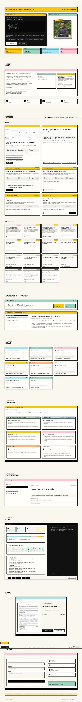 |  |
| Hero | 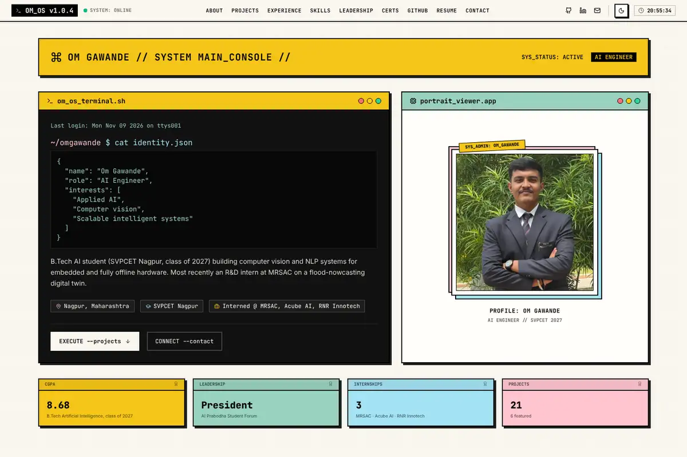 | 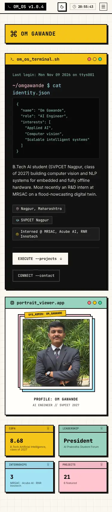 |
| About | 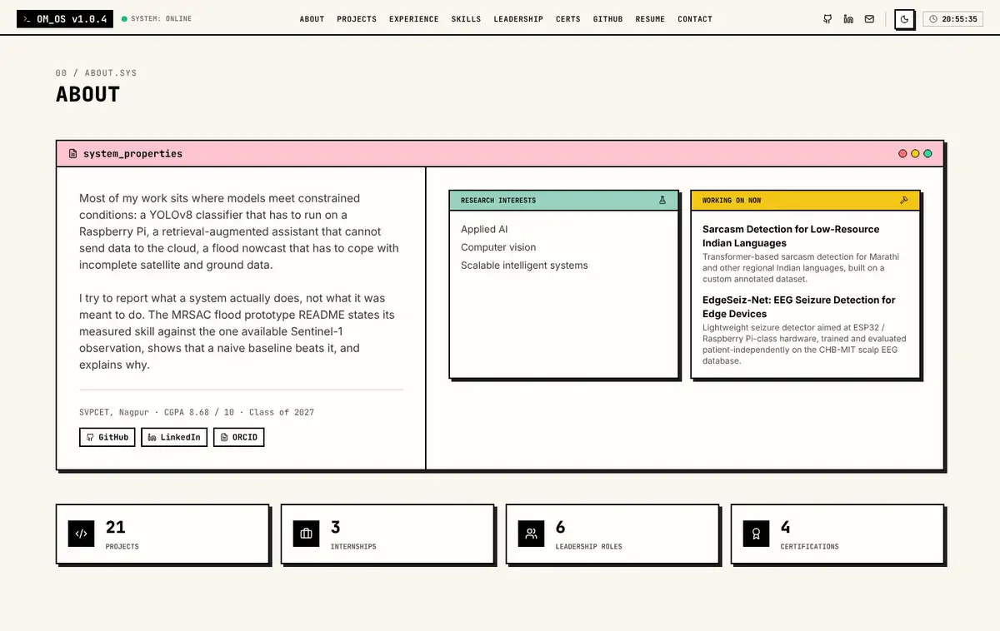 | 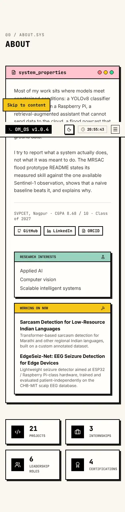 |
| Projects | 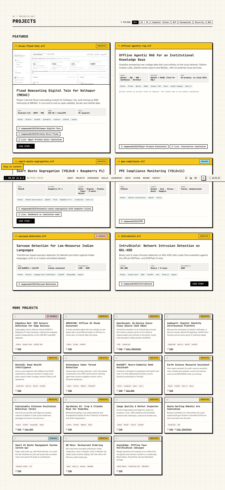 | 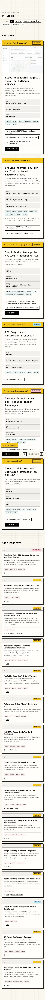 |
| Experience | 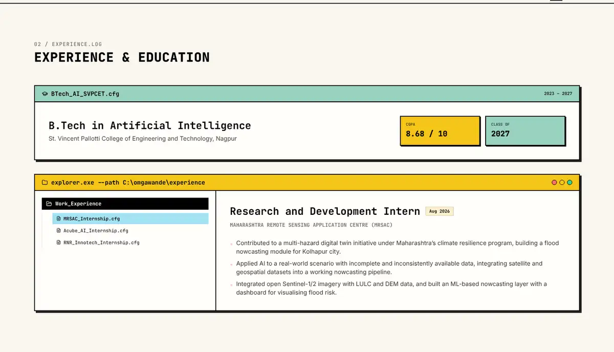 | 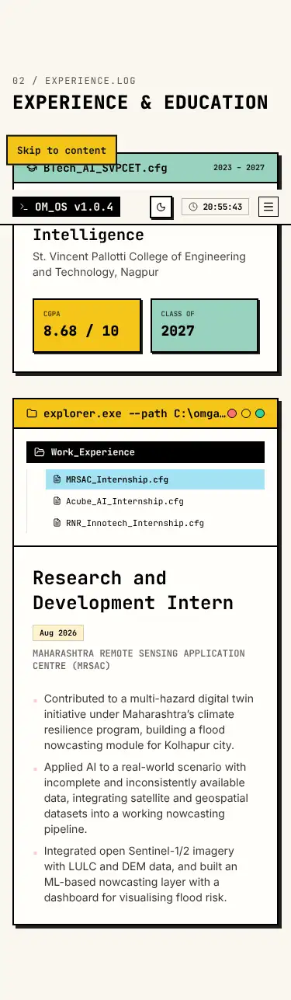 |
| Skills | 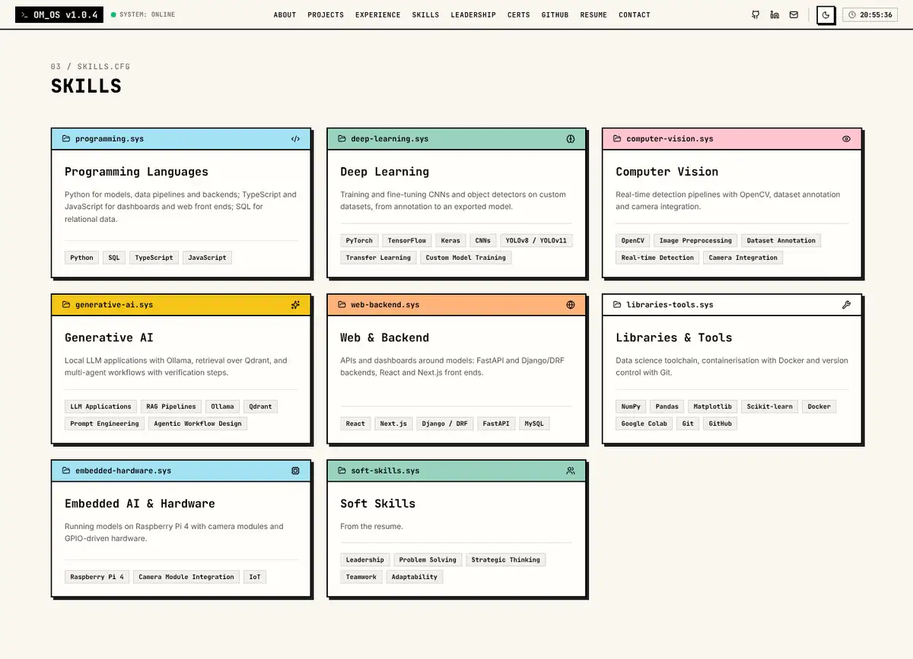 | 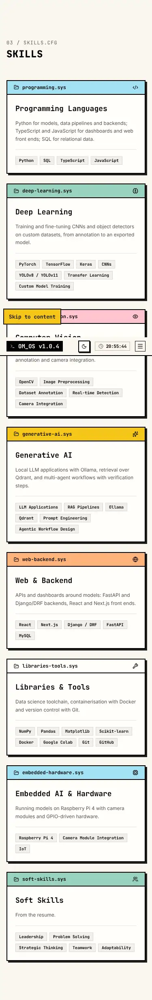 |
| Leadership | 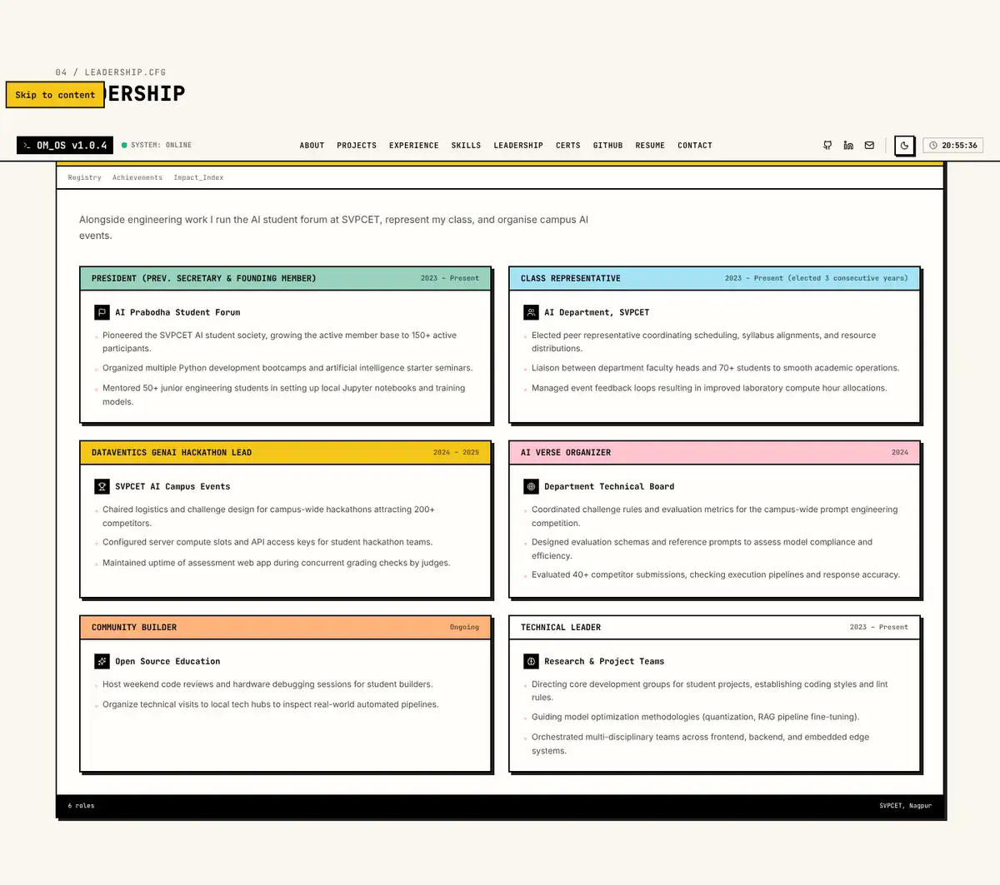 | 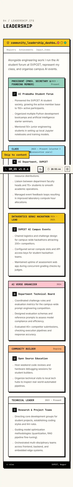 |
| Certifications | 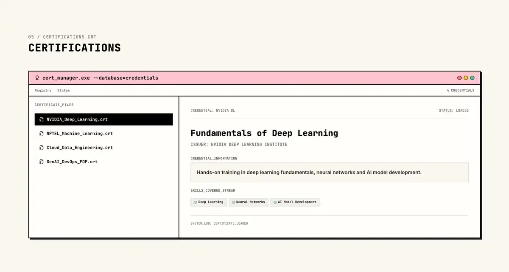 | 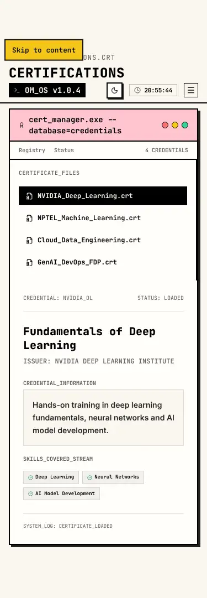 |
| GitHub | 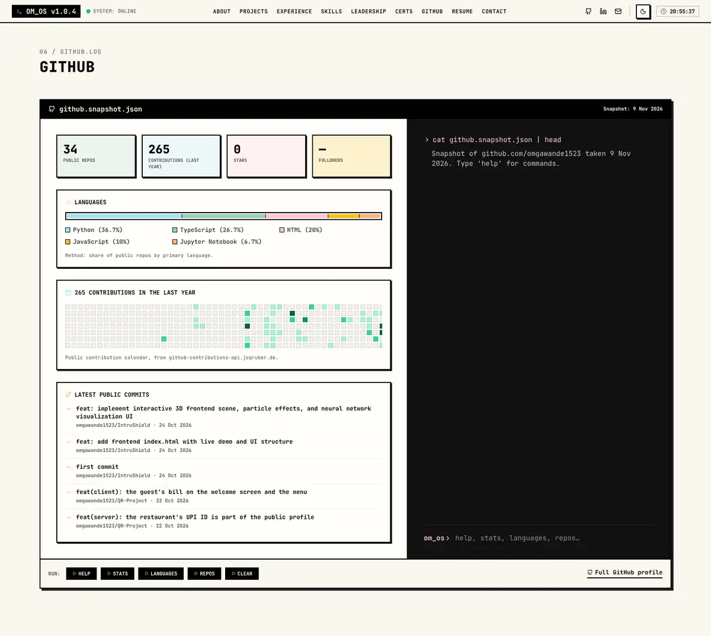 | 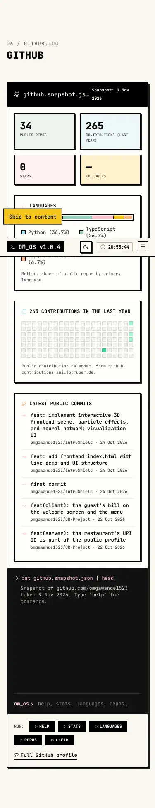 |
| Resume | 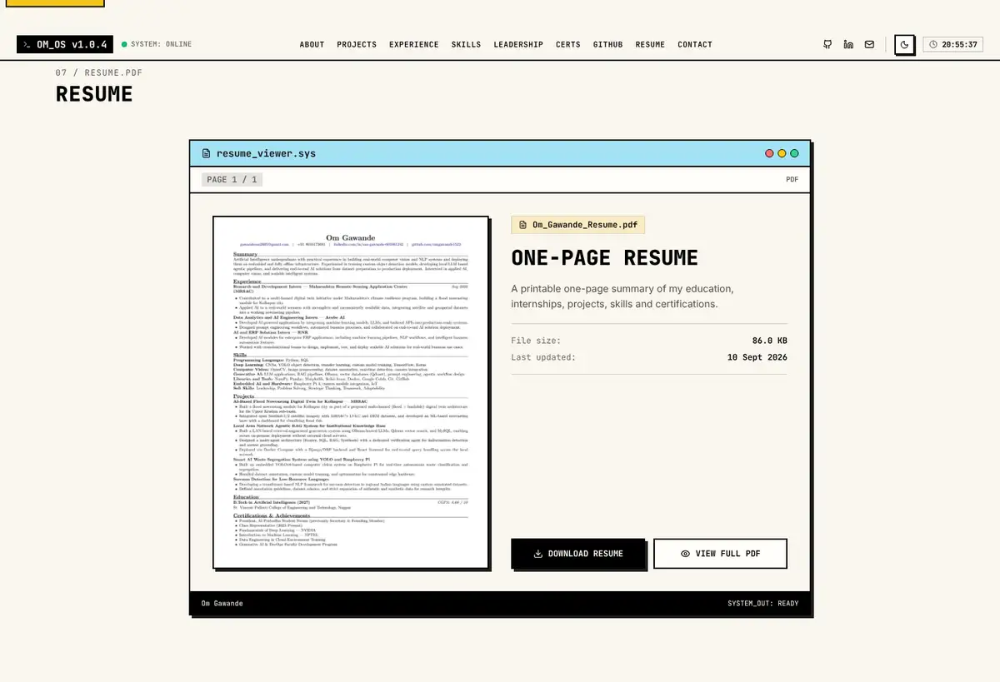 | 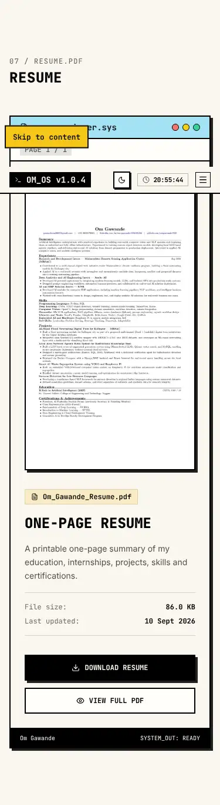 |
| Contact | 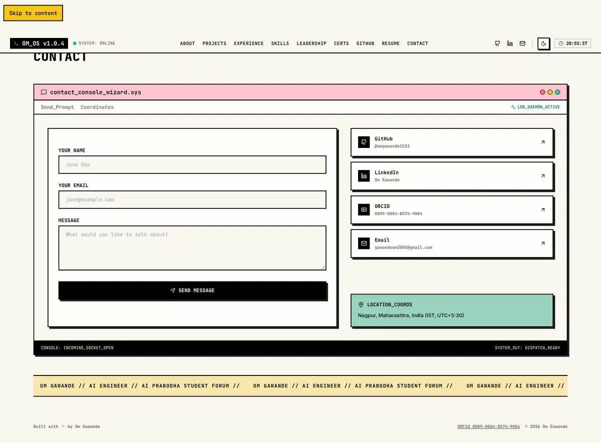 | 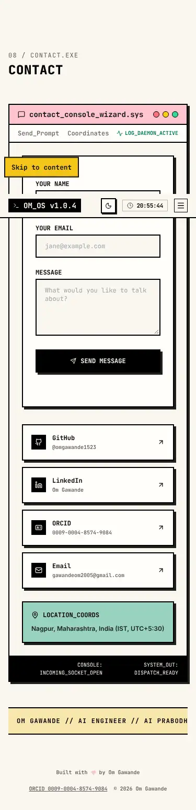 |

Baseline numbers for Part D: page height 12,276 px desktop / 23,623 px at 375 px; first load ≈ 310 KB; initial JS 85 KB gzip; Lighthouse mobile 98 / 100 / 100 / 100.
