# OM_OS v3: verification report (Part D)

All measurements on the production build (`npm run build` → `vite preview`), Playwright Chromium, 2026-11-09. "Before" = the v2 branch head (`06d052c`, identical to the PR #1 preview before this round).

## Before / after

| Metric | Before (v2) | After (v3) | Target |
|---|---|---|---|
| Page height, 1440 px | 12,276 px | **6,938 px** | ≈ 5 screens |
| Page height, 375 px | 23,623 px | **10,492 px** | < 12,000 px ✅ |
| First-load transfer (Pixel 5) | ≈ 310 KB | **313 KB** (232 KB site + 81 KB Google Fonts) | ≤ 350 KB ✅ |
| Initial JS (gzip) | 85 KB (+ 129 KB lazy three.js chunk) | **86.4 KB**, no three.js; palette 18.6 KB lazy on first open | new JS ≤ 25 KB ✅ (net +1.4 KB vs v2; +5.4 KB vs Part B) |
| Lighthouse mobile (perf / a11y / best practices / SEO) | 98 / 100 / 100 / 100 | **99 / 100 / 100 / 100** (FCP 1.6 s, LCP 2.0 s, TBT 10 ms, CLS 0) | ≥ 95 ×4 ✅ |
| Lighthouse desktop | 100 ×4 | **100 ×4** | |
| axe (wcag2a/aa + best-practice) | 0 | **0 violations of any impact in 32 checks** (below) | 0 serious/critical ✅ |
| Horizontal scroll | none at 360 | **none at 360 / 375** (with all projects and terminal output open) | ✅ |
| Prerendered content | ~2,250 words | ~1,860 words (duplicates removed) | |

## axe checks (1440 and 375 px, light and dark, reduced motion)

Each of these states was scanned in all four combinations: page, terminal output (after `help`, `whoami`, `ls projects`, `github`, `contact`), ⌘K command palette open, case-study dialog open, `?` shortcuts dialog open, mobile menu open (375 only), "Show all 15" + "Show all 6 roles" expanded, contact form errors. Result: **0 violations** in all 32 scans. One issue found during Part D (the `⌘K` button's accessible name didn't include its visible label) was fixed before this run.

Keyboard: Tab order reaches the terminal prompt; Tab with an empty prompt moves on, with text it completes; `3` jumps to Skills; `?` help lists `⌘K`; case-study dialog traps and returns focus (unchanged from v2).

## What was deleted

About section (interests box, "working on now", stat strip, duplicate links) · hero identity JSON, stat cards and chips · Certifications file browser · GitHub section (stats cards, language bars, commits list, second terminal, command tray) · Resume section and its preview images · marquee · footer bar, "Built with ♥", location card · project category filters · every fake status string and decorative menu tab (`SYS_ADMIN…`, `LOG_DAEMON_ACTIVE`, `System: Online`, `Registry / Achievements`, `File Edit Compile Help`, `.cfg/.crt/.elf` labels, `OM_OS v1.0.4`) · `CustomCursor` (trail + particles) · `ElasticThreadGrid` + `three`, `meshline`, `@types/three`.

## What was added

- **Hero terminal** (`src/components/Terminal.tsx`): `help`, `whoami`, `ls projects`, `open <slug>`, `cat resume`, `contact`, `github`, `theme`, `clear`, `sudo hire om`; Tab completion, ↑/↓ history, chips, `role="log"` output.
- **⌘K palette** (`src/components/CommandPalette.tsx`, cmdk, lazy): sections, all 21 projects, copy email, download resume, toggle theme, GitHub / LinkedIn / ORCID.
- **Demo loops**: `public/video/smart-waste-segregation.{webm,mp4}` (102 / 121 KB) and `offline-agentic-rag.{webm,mp4}` (163 / 163 KB), 6 s, with real poster frames; play only in view, never under reduced motion / Data Saver.
- Press effect, View Transitions for case studies, one-time name scramble, `last updated` in the footer.

## Fact trace: every number on the page

Extracted from the prerendered `dist/index.html` (all visible text containing a digit). Nothing was added in this round; the only change was removing `v1.0.4`, which had no source.

| Text on the page | Source |
|---|---|
| `01`–`05` section numbers | `src/data/sections.ts` (visible sections, numbered in order) |
| CGPA 8.68 / 10, 2023 – 2027, class of 2027 | `experience.ts` → `education` (resume) |
| Aug 2026 · Jun 2026 · Jun 2026 – Nov 2026 | `experience.ts` (resume + Om's confirmation) |
| 2023 – Present, 2024, 2024 – 2025, "elected 3 consecutive years" | `leadership.ts` (resume + Om) |
| 150+, 50+, 70+, 200+, 40+ | `leadership.ts` bullets, behind "Show all" (Om: "keep same") |
| 265 contributions · 9 Nov 2026 snapshot · last updated 9 Nov 2026 | `src/data/github.snapshot.json` (build-time API) |
| 95 (pytest), Sentinel-1/2, SCS-CN, KDDTest+/-21, 5-class, 6 bins, 11 districts, 6-DOF, five bins, SIH26104, 2026 | each project's README, via `projects.ts` |
| Show all 15, Show all 6 roles | `archiveProjects.length`, `leadership.length` |
| YOLOv8 / YOLOv11, Raspberry Pi 4, Lean 4, Sentinel-2, ESP32 | tool / model names from READMEs and the resume |
| 0009-0004-8574-9084, gawandeom2005@gmail.com, @omgawande1523 | `profile.ts` |
| IST, UTC+5:30 | time zone of `profile.location` (Nagpur) |
| © 2026 | build year (`__BUILD_YEAR__`) |

Terminal / palette output adds numbers only from the same sources (`github` reads the snapshot; `cat resume` prints the PDF size computed at build time).

## Screenshots

`docs/redesign/before/` and `docs/redesign/after/`, desktop (1440) and 375 px, per section.

| Section | Before desktop | After desktop | Before 375 | After 375 |
|---|---|---|---|---|
| Full page | 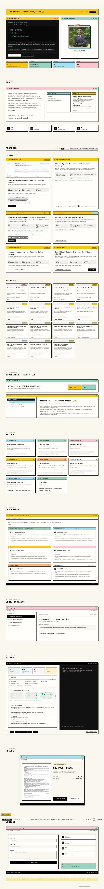 | 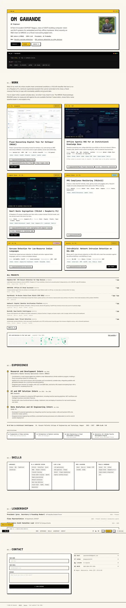 |  | 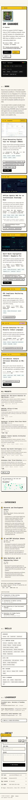 |
| Hero | 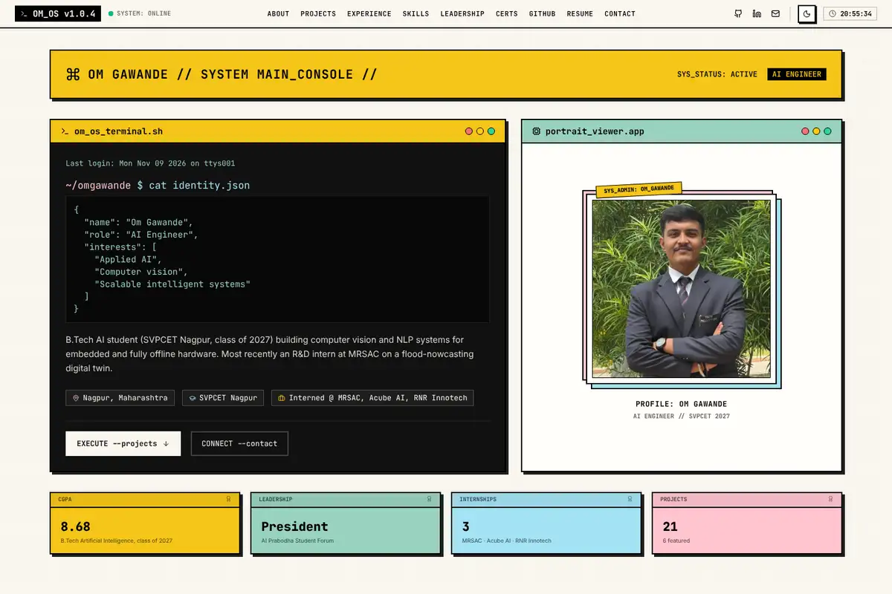 | 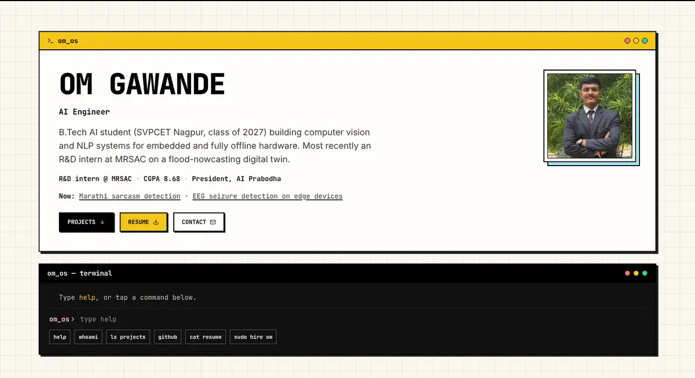 | 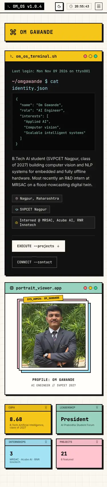 | 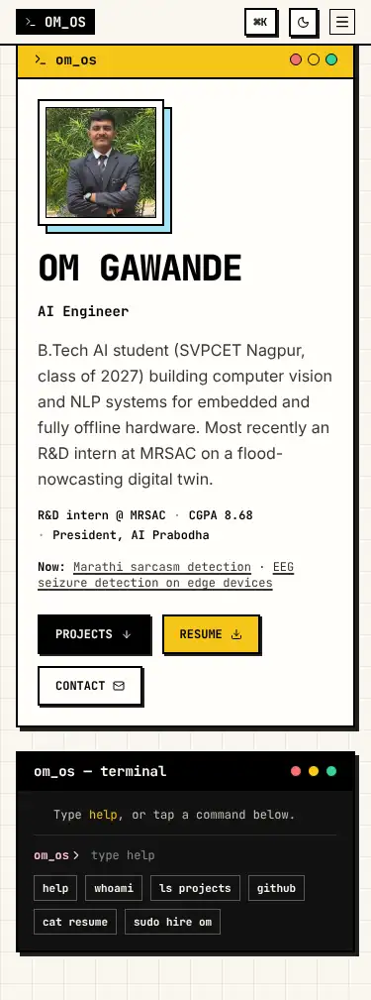 |
| Work (was Projects) | 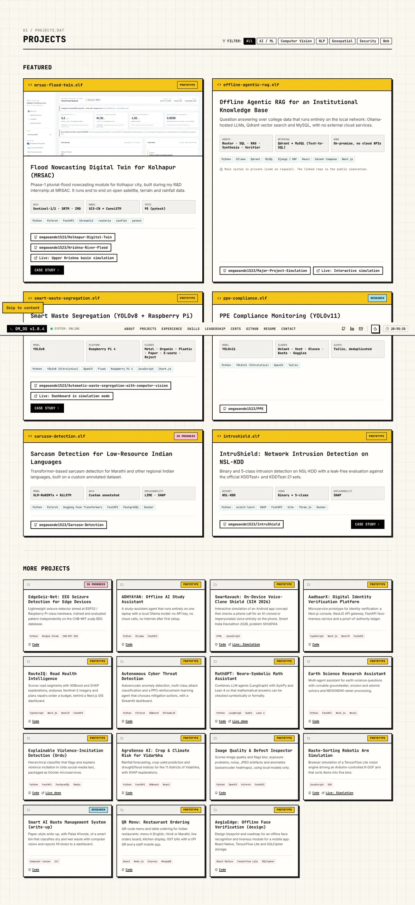 | 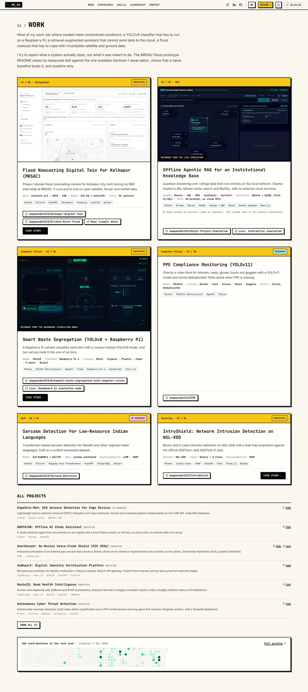 | 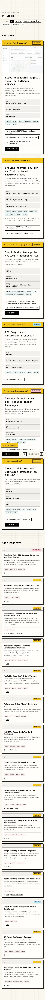 | 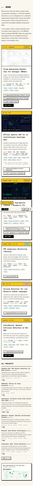 |
| Experience (+ certifications) | 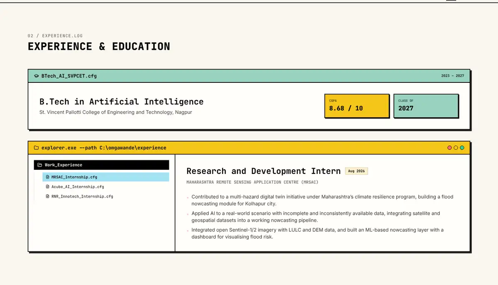 | 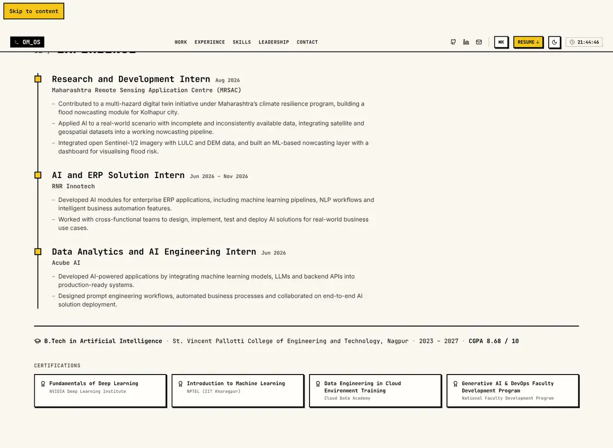 | 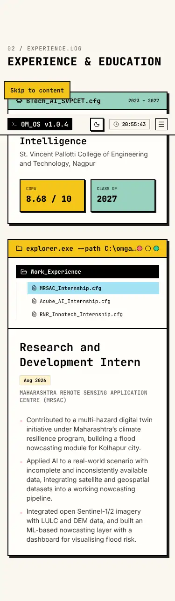 | 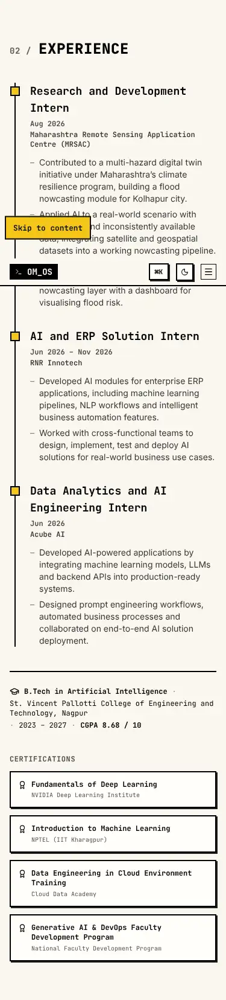 |
| Skills | 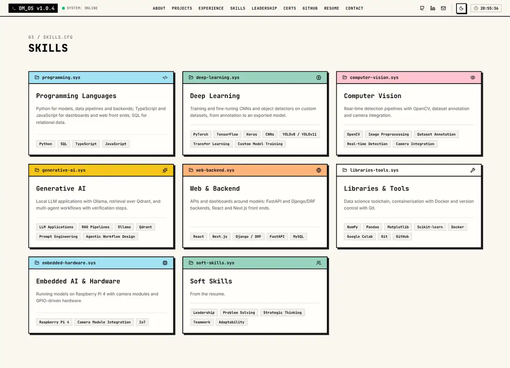 | 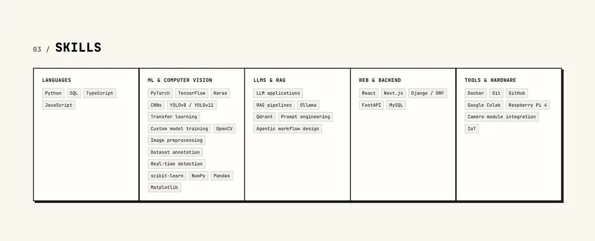 | 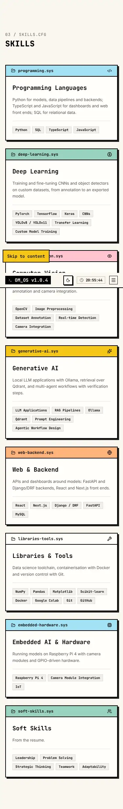 | 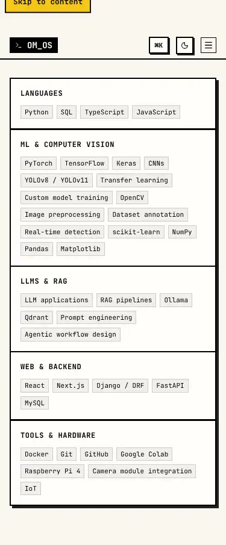 |
| Leadership | 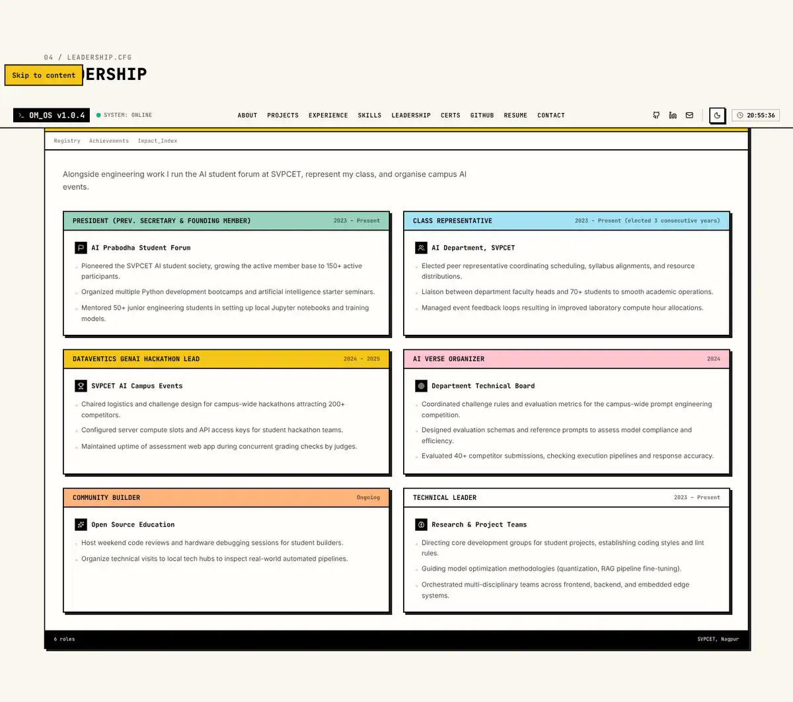 | 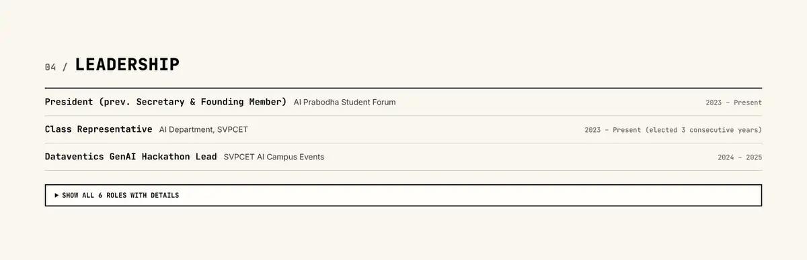 | 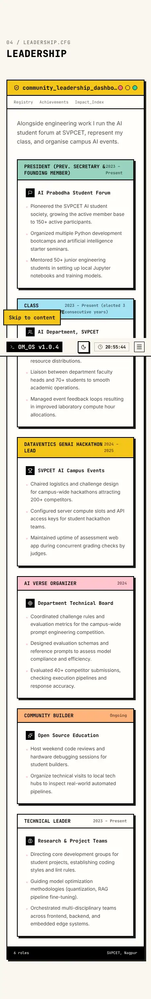 | 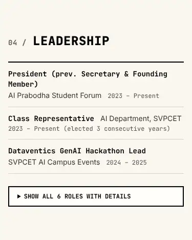 |
| Contact + footer | 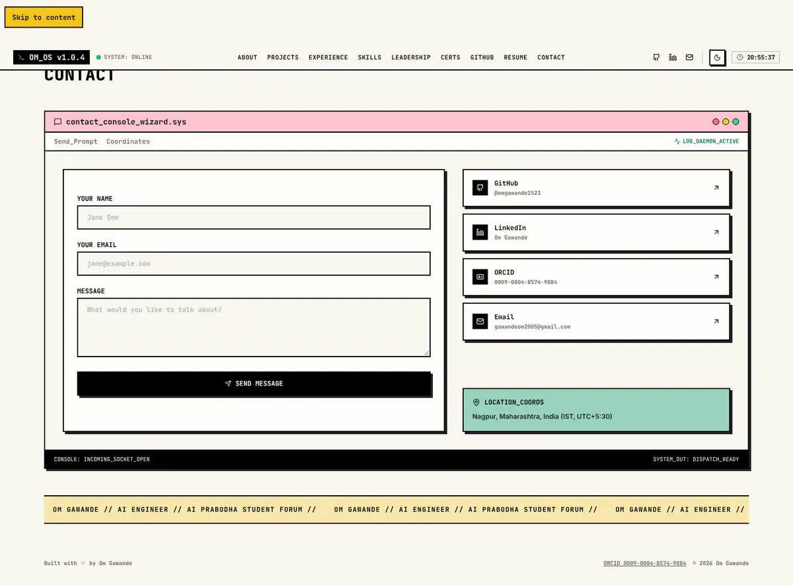 | 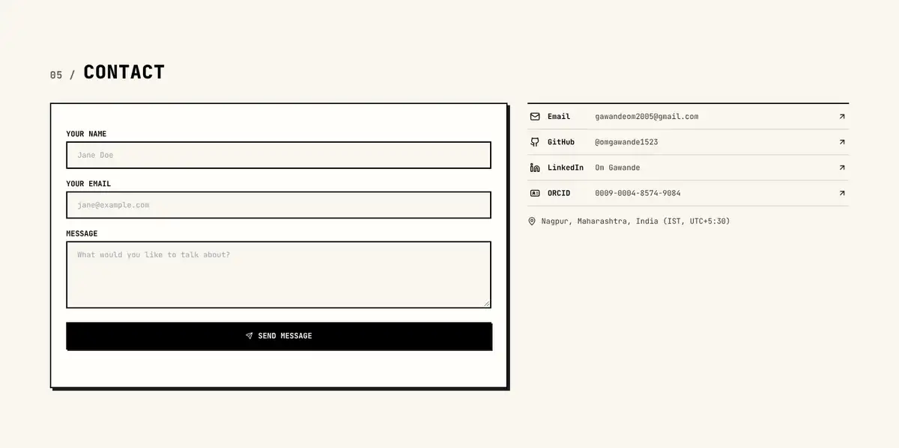 | 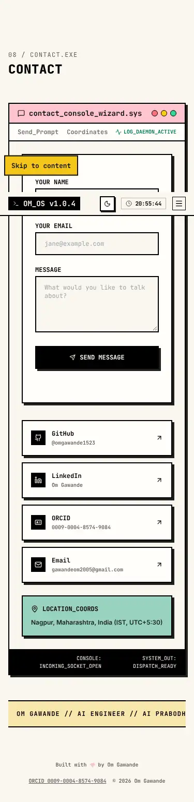 | 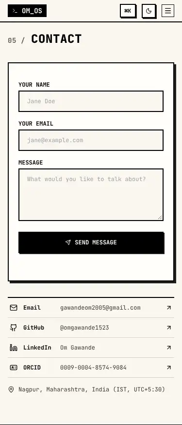 |
| Deleted: About, Certifications, GitHub, Resume | `before/*-about`, `*-certifications`, `*-github`, `*-resume` | – | | |
